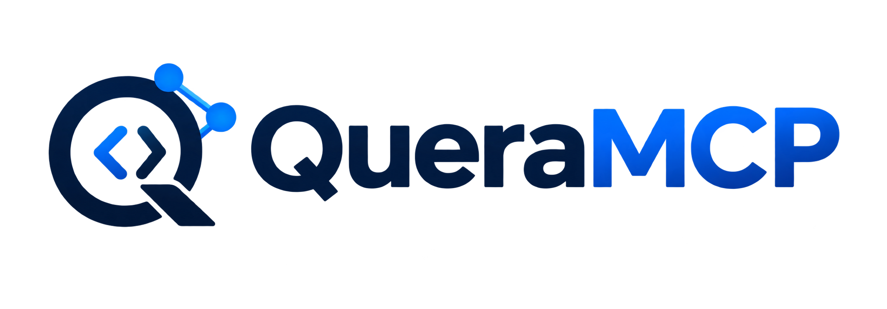

<div align="center">



### Quera, accessible to your AI agents.

**An MCP server that connects Quera to AI assistants, coding agents, and LLM-powered workflows.**

[](https://www.python.org/)
[](https://modelcontextprotocol.io/)
[](https://github.com/PrefectHQ/fastmcp)
[](#)
[](LICENSE)

[Features](#-features) · [Installation](#-installation) · [Available Tools](#-available-tools) · [AI Client Setup](#-connecting-to-ai-agents) · [Security](#-security)

</div>

---

## What is QueraMCP?

**QueraMCP** is a [Model Context Protocol (MCP)](https://modelcontextprotocol.io/) server that gives compatible AI assistants access to Quera through a collection of structured tools.

Instead of manually navigating Quera, retrieving problem statements, checking submissions, and tracking evaluation results, you can let your AI agent interact with these capabilities directly.

Connect QueraMCP to your preferred AI client and turn your assistant into a Quera-aware development companion.

### Why MCP?

MCP provides a standardized interface between AI applications and external tools. This means QueraMCP is not tied to a particular LLM, model provider, or AI application.

You can use it with compatible clients such as:

- OpenCode
- Claude Desktop
- Claude Code
- Cursor
- Visual Studio Code (GitHub Copilot)
- Windsurf
- Cline
- Gemini CLI
- OpenAI Codex
- Other MCP-compatible applications

---

## Features

- **Course discovery** — Retrieve your Quera courses.
- **Assignment exploration** — Browse assignments and retrieve their details.
- **Problem retrieval** — Access problem statements and metadata.
- **Submission history** — Inspect previous submissions and their scores.
- **Evaluation inspection** — Retrieve submission results.
- **Code submission** — Submit source code through Quera.
- **Submission management** — Mark submissions as final.
- **Current time** — Retrieve the current time exposed by the Quera client.
- **AI-agent integration** — Use Quera functionality directly from compatible MCP clients.
- **Local execution** — Run the server on your own machine using STDIO transport.

### Designed for AI-assisted problem solving

QueraMCP can be combined with project-level agent instructions to support a structured problem-solving workflow:

1. Retrieve a problem from Quera.
2. Understand its requirements and constraints.
3. Develop an implementation.
4. Review the implementation before submission.
5. Submit the solution after explicit authorization.
6. Inspect the evaluation result.
7. Analyze available feedback and identify potential issues.
8. Revise the implementation and repeat the process when authorized.

The goal is to make the entire workflow accessible to an AI agent while keeping important actions under the user's control.

---

### Technology stack

| Component | Technology |
|---|---|
| Language | Python |
| MCP implementation | FastMCP |
| Communication | MCP over STDIO |
| Authentication | Quera Client |
| HTTP communication | Requests |
| Configuration | Environment variables / `.env` |

---

## 📦 Installation

### Prerequisites

- Python 3.10 or newer.
- A working Quera account.
- Git.
- A compatible MCP client.
- Any additional browser dependencies required by your Quera Client authentication implementation.

### 1. Clone the repository

```bash
git clone https://github.com/AmirMJ-Z/QUeraMCP.git
cd QueraMCP
```

### 2. Create a virtual environment

QueraMCP uses a standard Python virtual environment.

```bash
python3 -m venv .venv
```

Activate it:

**Linux / macOS**

```bash
source .venv/bin/activate
```

**Windows (PowerShell)**

```powershell
.venv\Scripts\Activate.ps1
```

### 3. Install dependencies

```bash
python -m pip install --upgrade pip
pip install -r requirements.txt
```

### 4. Configure environment variables

Create a `.env` file in the project root:

```bash
touch .env
```

Add your Quera credentials and configuration:

```env
QUERA_USERNAME="your_quera_username"
QUERA_PASSWORD="your_quera_password"

QUERA_LOGIN_URL="https://quera.org/accounts/api/login/verify"
QUERA_MANUAL_LOGIN_URL="https://quera.org/accounts/login"
QUERA_COURSES_URL="https://quera.org/course"
QUERA_ASSIGNMENT_URL="https://quera.org/course/{}"
QUERA_PROBLEMS_URL="https://quera.org/course/assignments/{}/problems"
QUERA_PROBLEM_URL="https://quera.org/course/assignments/{}/problems/{}"
QUERA_DASHBOARD_URL="https://quera.org/dashboard"
QUERA_SUBMISSIONS_URL="https://quera.org/course/assignments/{}/submissions/all?page={}"
QUERA_SUBMISSION_ACTION_URL="https://quera.org/assignment/submission_action"
```

Replace the credentials with your own.

**Never commit your `.env` file or share your Quera credentials.**

### 5. Run the server

```bash
python server.py
```

QueraMCP uses STDIO transport. When launched directly, it waits for an MCP client to communicate with it. An apparently idle terminal is normal.

Stop the server with `Ctrl+C`.

---

## Available Tools

QueraMCP exposes the following MCP tools.

| Tool | Description |
|---|---|
| `get_courses` | Retrieve available Quera courses. |
| `get_assignments` | Retrieve assignments for a course. |
| `get_assignment_details` | Retrieve detailed information about an assignment. |
| `get_problems` | List problems belonging to an assignment. |
| `get_problem` | Retrieve a problem statement and its content. |
| `get_problem_metadata` | Retrieve problem metadata. |
| `submit_code_answer` | Submit source code for a problem. |
| `get_submissions` | Retrieve submission history for a problem. |
| `get_submission_result` | Retrieve the result of a submission. |
| `set_submission_final` | Mark a submission as final. |
| `get_current_time` | Retrieve the current time. |

Tool availability and returned information depend on the underlying Quera Client implementation and Quera's responses.

---

# Connecting to AI Agents

QueraMCP communicates through **MCP over STDIO**. Most local MCP clients can launch it directly using the Python interpreter inside its virtual environment.

The examples below assume the repository is located at:

```text
/home/YOUR_USERNAME/QueraMCP
```

Replace this path with the actual absolute path on your machine.

> **Important:** Use the Python executable inside `.venv`. This ensures the MCP server uses the dependencies installed for QueraMCP rather than relying on your system Python.

## 1. OpenCode

[OpenCode](https://opencode.ai/) supports local MCP servers through its configuration file.

Open your OpenCode configuration file:

```bash
mkdir -p ~/.config/opencode
```

Depending on your setup, configure either your global OpenCode configuration or your project's `opencode.json`.

Add the following configuration:

```json
{
  "$schema": "https://opencode.ai/config.json",
  "mcp": {
    "servers": {
      "QueraMCP": {
        "type": "local",
        "command": [
          "/home/YOUR_USERNAME/QueraMCP/.venv/bin/python",
          "/home/YOUR_USERNAME/QueraMCP/server.py"
        ],
        "cwd": "/home/YOUR_USERNAME/QueraMCP",
        "timeout": {
          "startup": 45000,
          "catalog": 30000,
          "execution": 600000
        },
        "codemode": false
      }
    }
  }
}
```

If you already have an OpenCode configuration, merge the `mcp` section into it instead of replacing the entire file.

### Verify the connection

```bash
opencode mcp list
```

Launch OpenCode and inspect the available MCP connections:

```text
/mcps
```

You should see `QueraMCP` listed as connected.

With `codemode` disabled, individual tools should be exposed directly, with names such as:

```text
QueraMCP_get_courses
QueraMCP_get_assignments
QueraMCP_get_problem
QueraMCP_submit_code_answer
```

---

## 2. Claude Desktop

[Claude Desktop](https://claude.ai/download) supports local MCP servers through its configuration file.

Open the Claude Desktop configuration file.

**Linux**

```text
~/.config/Claude/claude_desktop_config.json
```

**macOS**

```text
~/Library/Application Support/Claude/claude_desktop_config.json
```

**Windows**

```text
%APPDATA%\Claude\claude_desktop_config.json
```

Add:

```json
{
  "mcpServers": {
    "QueraMCP": {
      "command": "/home/YOUR_USERNAME/QueraMCP/.venv/bin/python",
      "args": [
        "/home/YOUR_USERNAME/QueraMCP/server.py"
      ],
      "env": {
        "PYTHONUNBUFFERED": "1"
      }
    }
  }
}
```

Save the configuration and restart Claude Desktop.

Claude Desktop should start QueraMCP automatically when it needs the server.

---

## 3. Claude Code

[Claude Code](https://docs.anthropic.com/en/docs/claude-code/overview) supports MCP servers through its built-in MCP management commands.

Register QueraMCP:

```bash
claude mcp add --transport stdio QueraMCP \
  -- /home/YOUR_USERNAME/QueraMCP/.venv/bin/python \
  /home/YOUR_USERNAME/QueraMCP/server.py
```

Inspect the registered servers:

```bash
claude mcp list
```

You can also inspect MCP connections from inside a Claude Code session using:

```text
/mcp
```

---

## 4. Cursor

[Cursor](https://cursor.com/) supports MCP servers through project-level or global configuration.

For project-level configuration, create:

```text
.cursor/mcp.json
```

Add:

```json
{
  "mcpServers": {
    "QueraMCP": {
      "command": "/home/YOUR_USERNAME/QueraMCP/.venv/bin/python",
      "args": [
        "/home/YOUR_USERNAME/QueraMCP/server.py"
      ],
      "env": {
        "PYTHONUNBUFFERED": "1"
      }
    }
  }
}
```

Restart Cursor or reload the MCP configuration.

You should then be able to use QueraMCP tools from Cursor's AI agent.

---

## 5. Visual Studio Code (GitHub Copilot)

[Visual Studio Code](https://code.visualstudio.com/) supports MCP servers through workspace configuration.

Create:

```text
.vscode/mcp.json
```

Add:

```json
{
  "servers": {
    "QueraMCP": {
      "type": "stdio",
      "command": "/home/YOUR_USERNAME/QueraMCP/.venv/bin/python",
      "args": [
        "/home/YOUR_USERNAME/QueraMCP/server.py"
      ],
      "env": {
        "PYTHONUNBUFFERED": "1"
      }
    }
  }
}
```

Open the Command Palette and search for:

```text
MCP: List Servers
```

Select `QueraMCP` and start the server.

You can now use its tools from compatible GitHub Copilot agent sessions.

---

## 6. Windsurf

[Windsurf](https://windsurf.com/) supports MCP through its MCP configuration file.

Open:

```text
~/.codeium/windsurf/mcp_config.json
```

Add:

```json
{
  "mcpServers": {
    "QueraMCP": {
      "command": "/home/YOUR_USERNAME/QueraMCP/.venv/bin/python",
      "args": [
        "/home/YOUR_USERNAME/QueraMCP/server.py"
      ],
      "env": {
        "PYTHONUNBUFFERED": "1"
      }
    }
  }
}
```

Save the file and restart or reload Windsurf.

---

## 7. Cline

[Cline](https://cline.bot/) supports external MCP servers.

Open the MCP Servers configuration in Cline and edit its MCP settings.

Add:

```json
{
  "mcpServers": {
    "QueraMCP": {
      "command": "/home/YOUR_USERNAME/QueraMCP/.venv/bin/python",
      "args": [
        "/home/YOUR_USERNAME/QueraMCP/server.py"
      ],
      "env": {
        "PYTHONUNBUFFERED": "1"
      },
      "disabled": false,
      "autoApprove": []
    }
  }
}
```

Save the configuration and enable the server.

---

## 8. Gemini CLI

[Gemini CLI](https://github.com/google-gemini/gemini-cli) supports MCP servers through its settings configuration.

Open or create:

```text
~/.gemini/settings.json
```

Add:

```json
{
  "mcpServers": {
    "QueraMCP": {
      "command": "/home/YOUR_USERNAME/QueraMCP/.venv/bin/python",
      "args": [
        "/home/YOUR_USERNAME/QueraMCP/server.py"
      ],
      "env": {
        "PYTHONUNBUFFERED": "1"
      }
    }
  }
}
```

Restart Gemini CLI to load the server.

---

## 9. OpenAI Codex

[OpenAI Codex](https://developers.openai.com/codex/) supports MCP servers through its configuration.

For a local STDIO server, add the following to:

```text
~/.codex/config.toml
```

```toml
[mcp_servers.QueraMCP]
command = "/home/YOUR_USERNAME/QueraMCP/.venv/bin/python"
args = ["/home/YOUR_USERNAME/QueraMCP/server.py"]
```

Restart Codex or reload its MCP configuration.

---

## 10. Other MCP-compatible applications

The configurations above use the standard local STDIO pattern.

For another MCP client, the essential configuration is generally:

```json
{
  "command": "/absolute/path/to/QueraMCP/.venv/bin/python",
  "args": [
    "/absolute/path/to/QueraMCP/server.py"
  ]
}
```

The exact configuration structure depends on the application.

Check your client's MCP documentation for its expected configuration format.

### What about ChatGPT?

ChatGPT's custom MCP connections use a remotely accessible MCP endpoint rather than launching a local STDIO process directly.

The current QueraMCP setup is a local STDIO server. Connecting it to ChatGPT therefore requires an appropriate remote transport and deployment setup. Do not expose your local Quera credentials or an unauthenticated server to the public internet.

---

# Agent Instructions

MCP tools provide capabilities. Agent instructions tell an AI assistant how to use those capabilities responsibly.

QueraMCP can be used alongside an `AGENTS.md` file containing project-specific instructions.

For example:

```text
QueraMCP/
├── server.py
├── QueraClient.py
├── RecaptchaSolver.py
├── requirements.txt
├── .env
├── AGENTS.md
└── .venv/
```

An `AGENTS.md` file can describe:

- How to discover courses and assignments.
- How to retrieve and understand problem statements.
- How to inspect submission history.
- How to interpret evaluation results.
- How to review code before submitting it.
- How to handle failed submissions.
- When explicit user authorization is required.

For clients that support project instructions, place `AGENTS.md` in the workspace root or configure the client to load it.

**Important:** MCP server instructions and agent instruction files are separate mechanisms. A client may support one, both, or neither.

---

# Security

QueraMCP interacts with a real Quera account. Treat its tools as account-access capabilities, not merely read-only utilities.

### Credential management

- Store credentials in `.env`.
- Never hardcode credentials in source code.
- Never commit `.env` to Git.
- Never print passwords, authentication cookies, or session tokens.
- Use a dedicated and appropriately secured environment.

### Protect your `.env`

Your `.gitignore` should include:

```gitignore
.env
.venv/
__pycache__/
*.py[cod]
quera.log
```

### Submission authorization

Code submission and finalization can modify your Quera account.

An AI agent should:

1. Present the code it intends to submit.
2. Explain what it is about to do.
3. Obtain explicit authorization before submitting.
4. Inspect the result after submission.
5. Obtain authorization again before submitting a revised solution.

Marking a submission as final should also require explicit authorization.

Do not configure an AI agent to submit code or finalize submissions without appropriate user oversight.

### Local execution

The recommended setup runs QueraMCP locally through STDIO. This avoids exposing a network-accessible endpoint unnecessarily.

Remember that any MCP client connected to QueraMCP may be able to invoke the tools exposed by the server. Review the available tools and the client's approval settings before using it.

---

# Troubleshooting

### `KeyError: 'QUERA_USERNAME'`

Make sure:

- Your `.env` file exists.
- It contains `QUERA_USERNAME` and `QUERA_PASSWORD`.
- `load_dotenv()` runs before the client is initialized.
- Your `QueraClient` constructor does not access `os.environ[...]` in default argument expressions.

Prefer:

```python
def __init__(
    self,
    identifier: str | None = None,
    credential: str | None = None
):
    identifier = identifier or os.getenv("QUERA_USERNAME")
    credential = credential or os.getenv("QUERA_PASSWORD")
```

### `ModuleNotFoundError`

Activate the virtual environment and install dependencies:

```bash
source .venv/bin/activate
pip install -r requirements.txt
```

Make sure your MCP client uses:

```text
/path/to/QueraMCP/.venv/bin/python
```

rather than the system Python interpreter.

### MCP server fails to start

Run the server manually:

```bash
cd /path/to/QueraMCP
source .venv/bin/activate
python server.py
```

Inspect the terminal output for missing dependencies, configuration errors, or authentication problems.

### MCP tools are not visible

Check:

1. Whether the server is registered in your AI client's MCP configuration.
2. Whether the Python executable points to the correct virtual environment.
3. Whether the server script path is correct.
4. Whether the client has restarted or reloaded its MCP configuration.
5. Whether the server can start independently.

### Authentication problems

Check your Quera credentials and the browser-related dependencies used by your authentication implementation. CAPTCHA and login behavior may change independently of QueraMCP.

---

# License

Distributed under the MIT License. See [`LICENSE`](LICENSE) for more information.

---

<div align="center">

### Built for developers. Designed for AI agents.

**QueraMCP — Bringing Quera into your AI workflow**

Amirreza Mirjalily

</div>